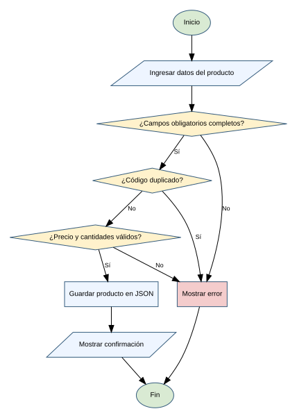
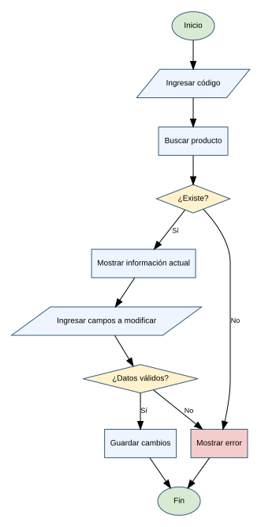
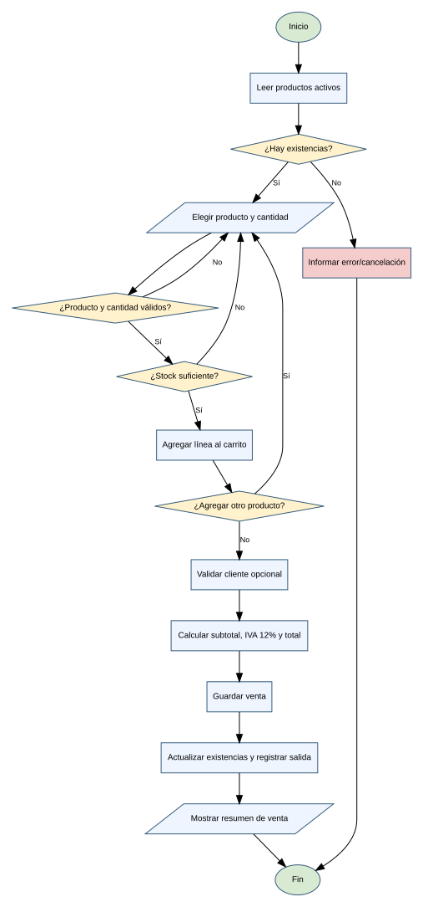
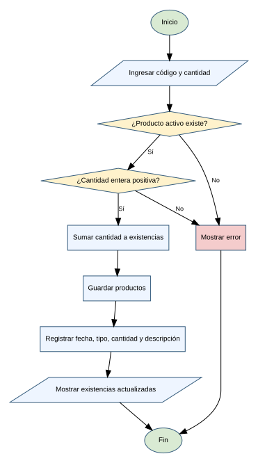
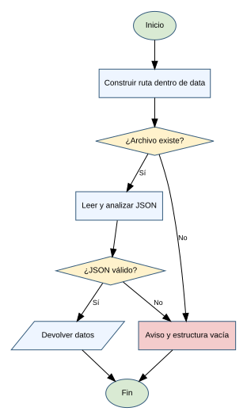
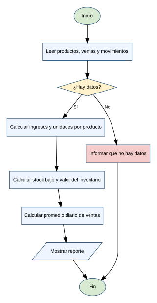

# Análisis de procesos funcionales

Cada proceso incluye los elementos pedidos: nombre, objetivo, descripción, entradas, procesamiento, salidas, reglas de negocio, validaciones/errores y diagrama de flujo (editable en `.mmd`/`.dot`, imagen en `.svg`).

## 1. Registro de productos
- **Nombre del proceso:** Registro de productos
- **Objetivo:** Añadir un producto identificable al catálogo.
- **Descripción del funcionamiento:** El usuario escribe los datos del producto; el sistema los valida uno por uno, comprueba que el código no exista y guarda el producto como activo. Si hay cantidad inicial, registra un movimiento de entrada.
- **Datos de entrada:** Código, nombre, categoría, precio de venta, cantidad inicial y stock mínimo.
- **Procesamiento realizado:** Limpiar textos, comprobar código único, validar números no negativos, guardar en `productos.json` y registrar el movimiento inicial.
- **Datos de salida:** Confirmación o mensaje de error.
- **Reglas de negocio:** Código único; precio y cantidades no negativos; nombre y categoría obligatorios.
- **Validaciones y posibles errores:** Código duplicado, campo vacío, valor no numérico o negativo, error de archivo.
- **Diagrama de flujo:**  (fuentes: `../diagramas/registro_producto.mmd`, `../diagramas/registro_producto.dot`)

## 2. Consulta y modificación de productos
- **Nombre del proceso:** Consulta y modificación de productos
- **Objetivo:** Recuperar información por código y mantenerla actualizada.
- **Descripción del funcionamiento:** El usuario indica un código; si existe se muestra o se piden los campos a cambiar (Enter conserva el valor actual) y se guarda. También permite desactivar y reactivar productos.
- **Datos de entrada:** Código y campos opcionales a modificar.
- **Procesamiento realizado:** Buscar coincidencia; validar solo los campos informados; guardar cambios.
- **Datos de salida:** Detalle del producto, confirmación o aviso de producto inexistente.
- **Reglas de negocio:** Precio y stock mínimo no negativos; la cantidad solo cambia con ventas o entradas; desactivar conserva el historial.
- **Validaciones y posibles errores:** Código inexistente, dato inválido, fallo de persistencia.
- **Diagrama de flujo:**  (fuentes: `../diagramas/consulta_modificacion.mmd`, `../diagramas/consulta_modificacion.dot`)

## 3. Registro de ventas
- **Nombre del proceso:** Registro de ventas
- **Objetivo:** Registrar una transacción, calcular impuestos y actualizar existencias.
- **Descripción del funcionamiento:** El usuario agrega productos y cantidades a un carrito, indica un cliente opcional y el sistema calcula subtotal, IVA y total, guarda la venta, descuenta existencias y registra salidas.
- **Datos de entrada:** Uno o más códigos de producto, cantidades y código de cliente opcional.
- **Procesamiento realizado:** Validar productos activos y cantidades, acumular líneas, calcular subtotal, IVA 12 % y total, asignar número consecutivo y fecha, guardar la venta, descontar stock y registrar movimientos de salida.
- **Datos de salida:** Comprobante en pantalla, registro en `ventas.json`, existencias actualizadas.
- **Reglas de negocio:** Cantidades enteras positivas; no vender más de lo disponible; el cliente debe existir si se indica; IVA = 12 % del subtotal general.
- **Validaciones y posibles errores:** Producto o cliente inexistente, cantidad inválida, stock insuficiente, error de archivo.
- **Diagrama de flujo:**  (fuentes: `../diagramas/registro_venta.mmd`, `../diagramas/registro_venta.dot`)

## 4. Actualización de inventario
- **Nombre del proceso:** Actualización de inventario
- **Objetivo:** Controlar entradas, salidas y niveles de existencias.
- **Descripción del funcionamiento:** El usuario registra una entrada indicando código, cantidad y descripción; el sistema suma las existencias y guarda el movimiento. Las salidas se generan automáticamente al vender.
- **Datos de entrada:** Código, cantidad y descripción de la entrada.
- **Procesamiento realizado:** Verificar producto activo, validar cantidad positiva, actualizar existencias y registrar fecha, código, tipo, cantidad y descripción.
- **Datos de salida:** Existencias actualizadas e historial de movimientos.
- **Reglas de negocio:** Las entradas deben ser positivas; stock bajo cuando cantidad ≤ stock mínimo.
- **Validaciones y posibles errores:** Código inexistente o inactivo, cantidad inválida, fallo al guardar.
- **Diagrama de flujo:**  (fuentes: `../diagramas/actualizacion_inventario.mmd`, `../diagramas/actualizacion_inventario.dot`)

## 5. Lectura y escritura de archivos
- **Nombre del proceso:** Lectura y escritura de archivos
- **Objetivo:** Conservar los datos entre ejecuciones.
- **Descripción del funcionamiento:** Cada módulo lee su JSON al necesitarlo y lo guarda tras cada cambio. Si el archivo no existe se parte de una lista vacía; si está dañado se conserva una copia de respaldo y se avisa.
- **Datos de entrada:** Nombre del archivo permitido y la estructura de datos.
- **Procesamiento realizado:** Leer JSON, manejar archivo ausente o dañado (respaldo `.bak`), guardar en un archivo temporal y reemplazar el destino.
- **Datos de salida:** Estructura cargada, aviso o confirmación implícita al guardar.
- **Reglas de negocio:** Los archivos viven en `data/`; no se aceptan rutas arbitrarias.
- **Validaciones y posibles errores:** Permisos, archivo dañado, datos con formato inesperado.
- **Diagrama de flujo:**  (fuentes: `../diagramas/lectura_archivos.mmd`, `../diagramas/lectura_archivos.dot`)

## 6. Generación de reportes
- **Nombre del proceso:** Generación de reportes
- **Objetivo:** Resumir catálogo, ventas, inventario y desempeño.
- **Descripción del funcionamiento:** El usuario elige un reporte; el sistema lee los archivos y calcula los resultados en el momento.
- **Datos de entrada:** Archivos `productos.json`, `ventas.json` y `clientes.json`.
- **Procesamiento realizado:** Recorrer los registros y calcular ingresos, unidades vendidas por producto, valor del inventario, productos bajo mínimo y promedios por día y por mes.
- **Datos de salida:** Reportes impresos en consola.
- **Reglas de negocio:** Las cifras se calculan desde datos guardados; los importes se muestran con dos decimales.
- **Validaciones y posibles errores:** Archivos vacíos o fechas no válidas (se omiten en los promedios).
- **Diagrama de flujo:**  (fuentes: `../diagramas/generacion_reportes.mmd`, `../diagramas/generacion_reportes.dot`)

## 7. Pruebas
Los casos, datos, resultados y conclusiones están en `../pruebas.md`. Las capturas reales deben guardarse en `../evidencias/`.
